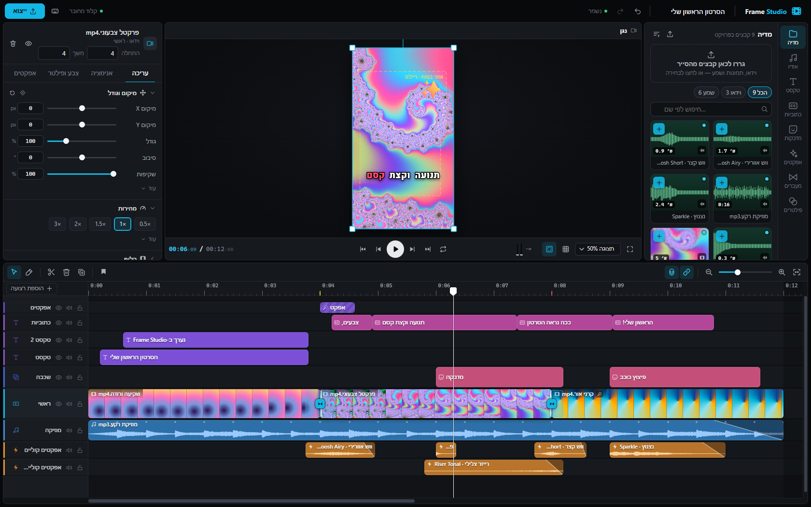
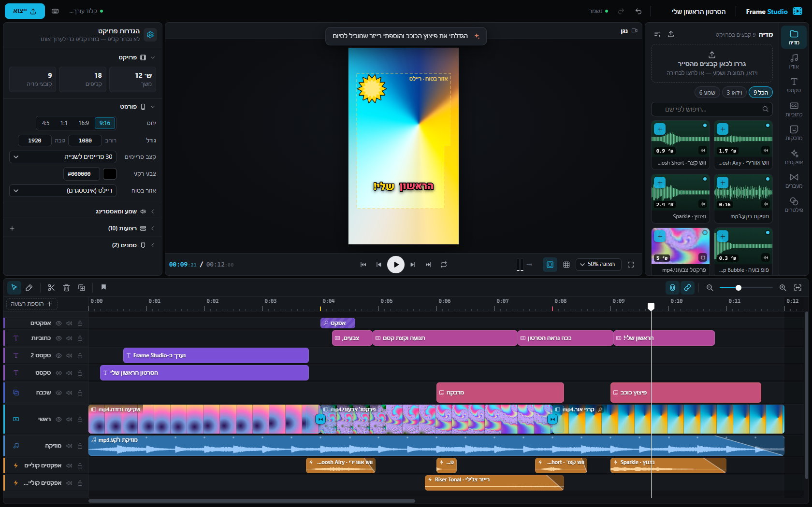
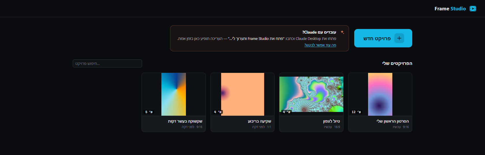
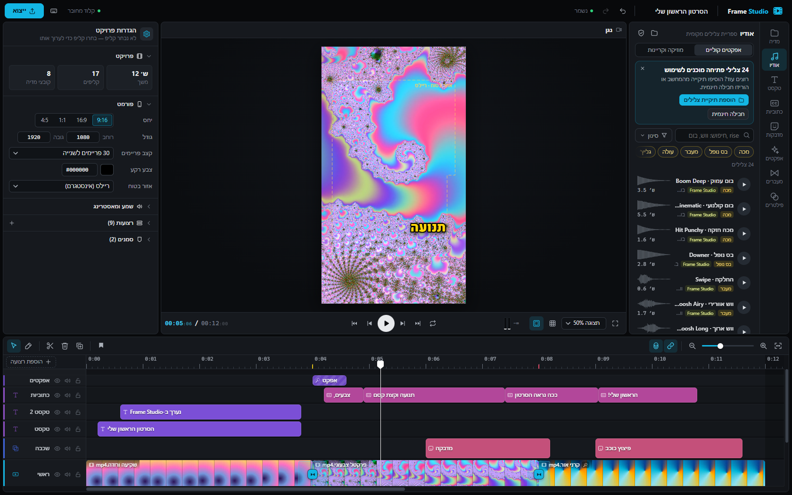
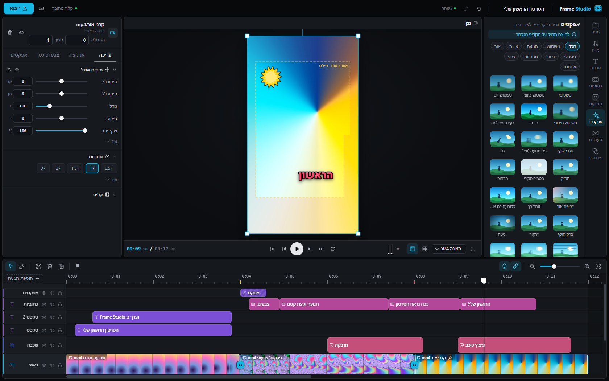
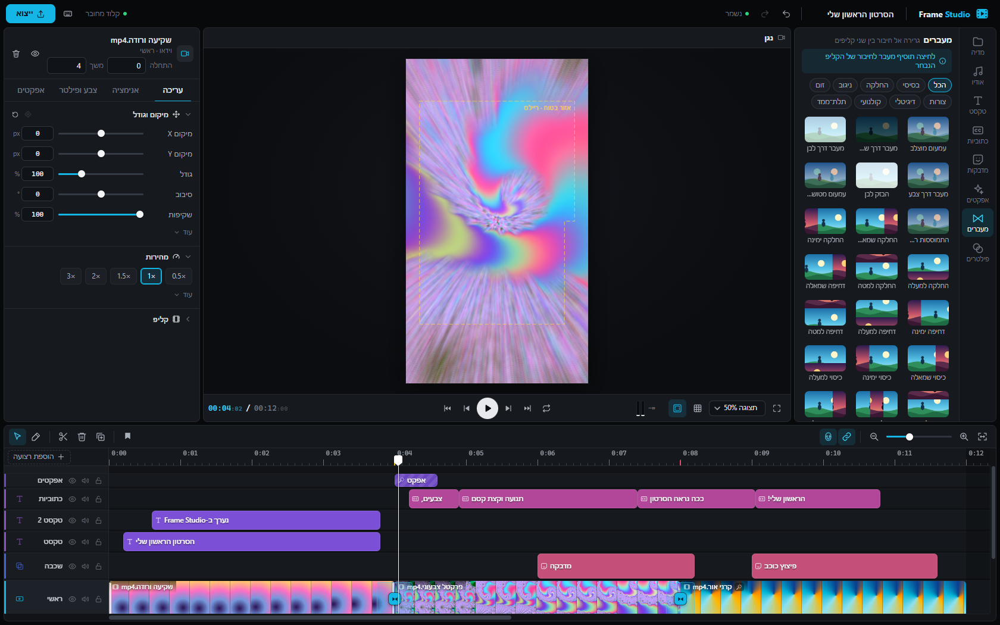
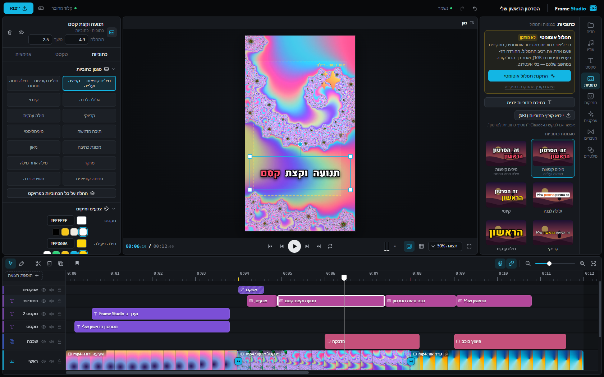
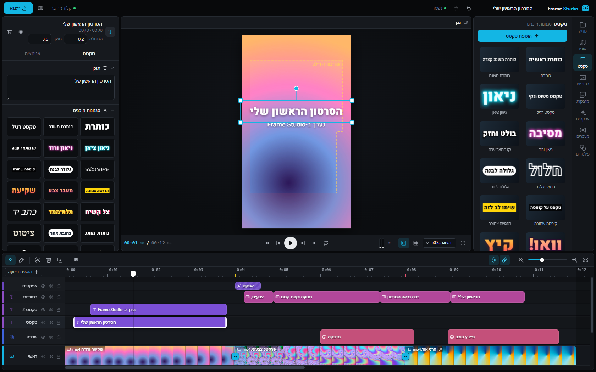

<div align="center">

# Frame Studio

### The video editor Claude can actually edit in.

A CapCut-style video editor that runs **100% offline on your computer**. You ask Claude for an edit in plain words,
you **watch the timeline change live**, and then you keep editing by hand.

**[התקנה בעברית](#התקנה-בשלושה-צעדים)** · **[Install (English)](#install-in-3-steps)** · [What it is](#what-it-is) · [For developers](#for-developers) · [Contributing](CONTRIBUTING.md)

</div>

---

<div dir="rtl">

## התקנה בשלושה צעדים

ל-**Windows 10 / 11**. בערך דקה, בלי הרשאות מנהל, ובלי להתקין שום דבר נוסף. צריך רק את אפליקציית **Claude**
(Claude Desktop) — מנוי Pro מספיק.

**1. פותחים מסוף.** לחיצה ימנית על כפתור **התחל** ← **מסוף** (Terminal; ב-Windows 10: **Windows PowerShell**).

**2. מדביקים את השורה הזו ולוחצים Enter:**

```powershell
irm https://raw.githubusercontent.com/YonatanProX/frame-studio/main/install.ps1 | iex
```

כשמופיעה השאלה **"Connect Frame Studio to Claude?"** (לחבר את Frame Studio לקלוד?) — לוחצים שוב **Enter** (= כן).
בסוף העורך נפתח לבד.

**3. מפעילים מחדש את Claude ומבקשים עריכה.** סוגרים את Claude **לגמרי**: לחיצה ימנית על הסמל שלו ליד השעון ← **Quit**
(סגירת החלון לא מספיקה). פותחים אותו שוב, פותחים צ'אט חדש וכותבים למשל:

> *פתח את Frame Studio ותערוך לי סרטון 9:16 מ-`C:\Users\השם-שלכם\Videos\video.mp4` עם כתוביות, ווש על כל חיתוך ומוזיקה שקטה מתחת לדיבור.*

בפעם הראשונה Claude שואל אם מותר לו להשתמש בכלים של Frame Studio — בוחרים **Allow always** (לאפשר תמיד).
העורך נפתח, ורואים את ציר הזמן משתנה בזמן אמת. אחר כך אפשר להמשיך לערוך ביד, או לבקש מ-Claude עוד שינויים.

> **טיפ:** כדי להעתיק נתיב של קובץ: **Shift + לחיצה ימנית** על הקובץ בסייר הקבצים ← **העתק כנתיב** (Copy as path).

### איפה הכול נמצא

- **פתיחת העורך:** הסמל **Frame Studio** בשולחן העבודה או בתפריט התחל.
- **הקבצים שלכם:** בתיקייה **מסמכים\Frame Studio** (`Documents\Frame Studio`). בתפריט התחל, **Frame Studio - my files**
  פותח אותה.
- **הסרטון המוכן:** בתיקייה `Documents\Frame Studio\projects\<הפרויקט>\exports`. בסוף הייצוא לוחצים בחלון הייצוא
  על **פתיחת התיקייה**, והיא נפתחת בסייר הקבצים.
  כש-Claude מייצא, הוא כותב לכם את הנתיב המלא של הקובץ.
- **עדכון:** מדביקים שוב את אותה שורה. ההגדרות, הפרויקטים והצלילים נשמרים.
- **הסרה:** תפריט התחל ← **Uninstall Frame Studio** (או הגדרות ← אפליקציות ← Frame Studio). הפרויקטים שבתיקייה
  מסמכים\Frame Studio נשמרים.

### צלילים

**יש כבר 24 אפקטים קוליים מובנים** (וושים, פופים, בומים, רייזרים, קליקים ועוד) — מקוריים, ומותר להשתמש בהם בכל סרטון,
גם מסחרי. רוצים אלפי צלילים נוספים בחינם?

1. מורידים את החבילה החינמית **Sonniss ‏#GameAudioGDC** מ-[sonniss.com/gameaudiogdc](https://sonniss.com/gameaudiogdc)
   (ללא תמלוגים, מותר גם בשימוש מסחרי, בלי קרדיט) וחולצים אותה לאן שנוח.
2. ב-Frame Studio: **אודיו** ← **אפקטים קוליים** ← **הוספת תיקיית צלילים**, ובוחרים את התיקייה.

שום דבר לא מועתק ולא מוזז — Frame Studio רק קורא את התיקייה. אפשר גם פשוט להעתיק תיקיות צלילים לתוך
**מסמכים\Frame Studio\Sounds**, והן מופיעות לבד. פרטים: [library/sounds/README.md](library/sounds/README.md#עברית).

### משהו לא עובד?

- **Claude לא מכיר את Frame Studio** — ודאו שסגרתם את Claude **לגמרי** (סמל ליד השעון ← Quit) ופתחתם מחדש. אם עניתם
  "לא" בהתקנה, או התקנתם את Claude רק אחרי Frame Studio — מדביקים שוב את שורת ההתקנה ועונים Enter.
- **העורך לא נפתח / משהו חסר** — מדביקים שוב את שורת ההתקנה; היא מתקנת הכול. יומן ההתקנה:
  `%LOCALAPPDATA%\Frame Studio\install.log`.
- עוד פתרונות: [docs/MCP.md](docs/MCP.md#troubleshooting) ו[פתרון בעיות](#פתרון-בעיות) למטה.

**בלי מסוף?** מורידים את `frame-studio-<version>.zip` מה-**[Release](https://github.com/YonatanProX/frame-studio/releases/latest)**
האחרון, לחיצה ימנית ← **חלץ הכל…** לתיקייה קבועה (למשל "מסמכים"), ולחיצה כפולה על **`install.cmd`** שבתוכה. אותם שלבים,
ו-Frame Studio רץ מהתיקייה הזו. אם Windows מציג "Windows הגן על המחשב שלך" — **מידע נוסף ← הפעל בכל זאת**.

**רשות — כתוביות אוטומטיות מהקול** (תמלול מקומי שרץ על המעבד): לחיצה כפולה על **`tools\install-transcription.cmd`**
בתיקיית התוכנה (`%LOCALAPPDATA%\Programs\Frame Studio`). בלי זה, אפשר לתת ל-Claude את הטקסט של הקריינות.

</div>

---

## Install in 3 steps

For **Windows 10 / 11**. About a minute, no administrator rights, nothing else to install. All you need is the
**Claude** app (Claude Desktop) — a Pro subscription is enough.

**1. Open a terminal.** Right-click the **Start** button → **Terminal** (on Windows 10: **Windows PowerShell**).

**2. Paste this line and press Enter:**

```powershell
irm https://raw.githubusercontent.com/YonatanProX/frame-studio/main/install.ps1 | iex
```

When it asks **"Connect Frame Studio to Claude?"**, press **Enter** again (= yes). At the end the editor opens by itself.

**3. Restart Claude and ask for an edit.** Quit Claude **completely**: right-click its icon next to the clock → **Quit**
(closing the window is not enough). Open it again, start a new chat and type, for example:

> *Open Frame Studio and make a 9:16 video from `C:\Users\you\Videos\video.mp4` with captions, a whoosh on every cut and quiet music under the voice.*

The first time, Claude asks whether it may use the Frame Studio tools — choose **Allow always**. The editor opens and
you watch the timeline change live. Then keep editing by hand, or ask Claude for more changes.

> **Tip:** to copy a file's path, **Shift + right-click** the file in File Explorer → **Copy as path**.

### Where everything is

- **Open the editor:** the **Frame Studio** icon on your Desktop or in the Start Menu.
- **Your files:** **Documents\Frame Studio**. In the Start Menu, **Frame Studio - my files** opens it.
- **Your finished video:** in `Documents\Frame Studio\projects\<project>\exports`. When an export ends, click
  **פתיחת התיקייה** (Open folder) in the export window and that folder opens in File Explorer. When Claude exports, it tells you the full path of the file.
- **Update:** paste the same line again. Your settings, projects and sounds are kept.
- **Uninstall:** Start Menu → **Uninstall Frame Studio** (or Settings → Apps → Frame Studio). Your projects in
  Documents\Frame Studio are kept.

### Sounds

**24 built-in sound effects are already there** (whooshes, pops, booms, risers, clicks and more). They are original,
and you may use them in any video, commercial too. Want thousands more, for free?

1. Download the free **Sonniss #GameAudioGDC** bundle from [sonniss.com/gameaudiogdc](https://sonniss.com/gameaudiogdc)
   (royalty-free, commercial use allowed, no credit needed) and unzip it anywhere.
2. In Frame Studio: **אודיו** (Audio) → **אפקטים קוליים** (Sound effects) → **הוספת תיקיית צלילים** (Add a sound folder),
   and pick that folder.

Nothing is copied or moved — Frame Studio only reads the folder. You can also simply copy sound folders into
**Documents\Frame Studio\Sounds**; they show up by themselves. Details: [library/sounds/README.md](library/sounds/README.md).

### Something does not work?

- **Claude does not know Frame Studio** — make sure you quit Claude **completely** (icon next to the clock → Quit) and
  opened it again. If you answered "no" during setup, or installed Claude after Frame Studio, paste the install line
  again and press Enter at the question.
- **The editor does not open / something is missing** — paste the install line again; it repairs everything. The
  installer log is `%LOCALAPPDATA%\Frame Studio\install.log`.
- More: [docs/MCP.md](docs/MCP.md#troubleshooting) and [Troubleshooting](#troubleshooting) below.

**Prefer not to use the terminal?** Download `frame-studio-<version>.zip` from the latest
**[Release](https://github.com/YonatanProX/frame-studio/releases/latest)**, right-click it → **Extract All…** into a
folder you will keep (e.g. *Documents*), and double-click **`install.cmd`** in it. Same steps, and Frame Studio runs
from that folder. If Windows shows *"Windows protected your PC"*, click **More info → Run anyway**.

**Optional — automatic captions from the voice** (local transcription on your CPU): double-click
**`tools\install-transcription.cmd`** in the Frame Studio folder (`%LOCALAPPDATA%\Programs\Frame Studio`). Without it,
you can give Claude the text of the voice-over instead.

---

## What it is



Most AI video tools either generate a finished clip you can't touch, or edit through a fragile chain of mouse clicks.
Frame Studio takes a different route: **the edit itself is data**. Every change — adding a clip, a whoosh on a word, a
keyframe, a caption style — is a small JSON *operation*. Claude sends operations through its Frame Studio tools (an MCP
server), the `cutx` command line or the local HTTP API; the editor window updates instantly, flashes what changed and
shows *"Claude edited: …"*. Your own edits in the UI go through the exact same operation engine, so you and Claude work
on the same timeline, with the same 300-step undo history.



Claude can also **see** its work: snapshots render exact frames with the export renderer, Claude looks at them, fixes
what looks off, and exports a loudness-normalized MP4 with a report.

- **Local-first.** Node server with zero npm dependencies, a Chrome / Edge app window, WebGL2 rendering, ffmpeg. No cloud, no account, no upload.
- **Social-video focus.** 9:16 1080×1920 by default (16:9, 1:1, 4:5 and custom too), safe-area guides for Reels / TikTok / Shorts.
- **Hebrew first, RTL done right** — and fine for any left-to-right language.

## Features

**Editing**
- Multi-track timeline: main / overlay / text / captions / effects tracks, voice / music / SFX audio tracks; magnetic main track, snapping, markers, in/out range, blade tool, multi-select, copy/paste, J/K/L shuttle.
- Pro operations: ripple delete, insert gap, close gaps, slip, overwrite / insert edits, split at playhead, detach audio, adjustment and effect layers that apply to everything below them.
- **48 operation types** in the engine — everything the UI does, Claude can do (`cutx help ops`).
- Speed and reverse, crop, fit modes, blend modes (multiply, screen, overlay, add, soft light, difference…).
- **Keyframes** on position, scale, rotation, opacity, volume, crop, every color control and every effect parameter, with **35 easing curves** (spring, bounce, back, elastic, expo, sine…).
- **Clip animations**: 20 in, 16 out, 15 loop (pop, whip, glitch, Ken Burns, breathe, heartbeat…).

**Look**
- **54 transitions** (crossfade, push, cover, wipes, whip pans, zoom blur, cross zoom, ink spread, glitch, film burn, cube, doorway, page flip…).
- **51 effects** (zoom punch, shake, shockwave, light leak, bloom, VHS, CRT, film grain, RGB split, kaleidoscope, thermal, halftone, drop shadow…).
- **27 filters**, full color panel (exposure, contrast, temperature, tint, highlights, shadows, vibrance, vignette, grain, fade…) and **.cube LUTs** (8 built-in, drop in your own).
- **Chroma key** (color, similarity, smoothness, spill), **masks** (rectangle, ellipse, linear, mirror; feather, invert).

**Text & captions**
- **Captions with word timing** — **14 caption styles** (karaoke, word pop, kinetic, pill, box highlight, typewriter, neon…), hot words in a second color, per-word animation. Proper **Hebrew RTL** layout with mixed Latin/numbers, niqqud-aware word matching.
- **38 text presets** and per-word / per-character **text animations** (33 in, 19 out, 17 loop: typewriter, word pop, char drop, karaoke fill, wave, shimmer…).
- **98 stickers** (65 emoji + 33 vector stickers drawn in code) and **23 shapes** (arrows, bursts, progress bars…).
- Fonts: Heebo and Assistant bundled (SIL OFL), plus your Windows fonts.
- Optional **local Whisper transcription** (faster-whisper, CPU) → word timestamps → captions in one command.

**Audio**
- WebAudio engine with per-clip volume / pan / fades, **voice enhance**, denoise, EQ presets, **automatic ducking** of music and SFX under the voice, master meters.
- Sound-effects library with search, categories, waveforms and audition: **24 built-in sounds**, plus any sound folder you add (see [Sounds](#sounds)).
- **Export at −14 LUFS** (true peak ≤ −1 dBTP) with a **speech-over-background check**: voice vs. music + SFX margin measured in 0.1 s windows, reported with timestamps.

**Made for an AI collaborator**
- Claude tools (MCP server, 19 tools), `cutx` CLI and HTTP API; JSON ops with time references like `word:"eggs"`, `marker:drop`, `clip:logo:end`.
- **Snapshots** so Claude can *see* frames (a contact sheet for many at once).
- Live sync over SSE: the editor shows each Claude edit with a toast and a flash on the changed clips.

| | |
|---|---|
|  |  |
|  |  |
|  |  |

## Troubleshooting

- **Claude does not mention Frame Studio** — quit Claude completely (tray icon → Quit) and open it again. Claude
  Desktop → Settings → Developer should show `frame-studio` as *running*. More in [docs/MCP.md](docs/MCP.md#troubleshooting).
- **Something is missing / the editor does not open** — run the installer again (the same line, or `install.cmd`); it
  repairs everything. The installer log is `%LOCALAPPDATA%\Frame Studio\install.log`.
- **"Port 7788 is used by another program"** — another app holds the port; close it (or run the server with `--port`).
- **The server did not start** — see `server.log` in the Frame Studio folder (`%LOCALAPPDATA%\Programs\Frame Studio`).
- **Export fails, the editor works** — exports need Google Chrome or Microsoft Edge. Run the installer again: its
  *Final check* step shows which browser, ffmpeg and Node.js Frame Studio uses (developers: `npm run check`).

---

## For developers

Everything below is for people who want to look under the hood, set things up by hand, or contribute. You do not need
any of it to use Frame Studio.

### Connecting Claude by hand

The installer does this for you. To do it yourself:

- **Claude Desktop** → Settings → Developer → Edit Config, and add (with your own user name):

  ```json
  { "mcpServers": { "frame-studio": {
      "command": "C:\\Users\\you\\AppData\\Local\\Programs\\Frame Studio\\runtime\\node\\node.exe",
      "args": ["C:\\Users\\you\\AppData\\Local\\Programs\\Frame Studio\\mcp\\server.mjs"] } } }
  ```

  If your computer already had Node.js 24+, the installer did not download a private copy, and `command` is that
  `node.exe` instead (`where node` shows it). Then quit and reopen Claude.
- **Claude Code**: the installer copies the Frame Studio skill to `%USERPROFILE%\.claude\skills\frame-studio` and
  registers the MCP server: `claude mcp add --scope user frame-studio -- "<node.exe>" "<Frame Studio>\mcp\server.mjs"`
  (with the `claude` command, or the copy of Claude Code that came with Claude Desktop; without either, it writes the
  same entry into `%USERPROFILE%\.claude.json`). The `cutx` command works in any new terminal.

Details, the list of tools and settings: [docs/MCP.md](docs/MCP.md).

### Requirements

On Windows **the installer takes care of all of these** — it downloads private copies of Node.js and ffmpeg when the computer has none.

| | |
|---|---|
| OS | **Windows 10 / 11** (tested). macOS / Linux: the code auto-detects Chrome and ffmpeg there too, but it is untested — reports and PRs welcome. |
| Node.js | **24+** (built-in `fetch` / `WebSocket`; there is **no `npm install`**) |
| Browser | **Google Chrome** or **Microsoft Edge** (the editor window, and headless rendering for snapshots and export) |
| ffmpeg | `ffmpeg` and `ffprobe` (a full build with libx264 — e.g. the gyan.dev builds on Windows — the installer downloads one) |
| Optional | Python 3.10–3.13 with [`faster-whisper`](https://github.com/SYSTRAN/faster-whisper) for local transcription (`tools\install-transcription.cmd` sets it up) |

### Manual install (developers, macOS / Linux)

```bash
git clone https://github.com/YonatanProX/frame-studio.git
cd frame-studio
node tools/check-setup.mjs    # what is found / missing (Node 24+, ffmpeg, ffprobe, Chrome / Edge, transcription)
node server/main.mjs          # or: npm start — then open http://127.0.0.1:7788
```

On Windows, `install.cmd` (or `npm run install-app`) does the setup in place; `start.cmd` is the daily launcher that the
desktop shortcut runs — it starts the local server (minimized) and opens the editor in a Chrome / Edge app window.
Installer options: `install.cmd -DryRun` (only show what it would do), `-Yes` (no question), `-NoStart`, `-NoShortcut`,
`-NoClaude`, `-NoPath`.

The server listens on `127.0.0.1:7788` only. Logs go to `server.log`. In a git clone, projects are saved in
`projects/<id>/` inside the clone (an installed copy uses `Documents\Frame Studio\projects`); they are auto-saved after
every change, and exports go to `projects/<id>/exports/`.

### Configuration (optional)

Everything machine-specific lives in **`config.json`** (gitignored; the installer creates it). All keys are documented in
[`config.example.json`](config.example.json); set only what you need:

```json
{
  "chrome": null,
  "ffmpeg": "ffmpeg",
  "asr": { "python": "C:/Users/you/AppData/Local/Frame Studio/asr/Scripts/python.exe", "model": "small", "language": "he" },
  "library": { "music": ["D:/My music"] }
}
```

- `dataDir` — where projects (`projects/`) and the drop-in sound folder (`Sounds/`) live. `null` = the Frame Studio
  folder for a git clone, else `Documents/Frame Studio`.
- `chrome` — `null` auto-detects Google Chrome, Chromium or Microsoft Edge (in that order).
- `ffmpeg` / `ffprobe` — a name on `PATH` or a full path. If neither works, the server also looks in the usual install folders (winget, Chocolatey, Scoop, `C:\ffmpeg\bin`, Homebrew).
- `asr.python` — a Python with `faster-whisper`. Without it, transcription is simply disabled and the editor tells you how to enable it.
- `library.music` — your own music / voice-over folders, shown in the Audio tab as "mine".
- Environment variables still win: `FRAME_STUDIO_DATA`, `FRAME_STUDIO_CHROME`, `FRAME_STUDIO_FFMPEG`, `FRAME_STUDIO_FFPROBE`, `FRAME_STUDIO_ASR_PYTHON`, `FRAME_STUDIO_PORT`, `FRAME_STUDIO_CONFIG`.

### Local transcription (optional)

Windows: double-click **`tools\install-transcription.cmd`**. It finds Python 3.10–3.13 or installs Python 3.12 from python.org for your user only, creates a private
environment in `%LOCALAPPDATA%\Frame Studio\asr`, installs `faster-whisper`, downloads the speech model once
(`asr.model`, `small` ≈ 500 MB) and writes `asr.python` into `config.json`. Elsewhere: `pip install faster-whisper` in a
virtual environment and set `asr.python` to its Python.

### Use it with Claude Code

1. Open the Frame Studio folder in [Claude Code](https://claude.com/claude-code) (the installer also puts the skill in
   your user folder, so any Claude Code session knows it).
2. The bundled skill **[`.claude/skills/frame-studio`](.claude/skills/frame-studio/SKILL.md)** teaches Claude the
   workflow: the Frame Studio MCP tools when they are connected, otherwise the `cutx` CLI. The full reference is
   **[`docs/CLAUDE-API.md`](docs/CLAUDE-API.md)** (ops, time references, catalogs, recipes).
3. Ask for an edit and watch it happen:

   > *"Open project `my-video`, put `intro.mp4` on the main track, add karaoke captions from the voice-over,
   > a whoosh on every zoom and a boom right before the drop. Snapshot the hook and show me."*

Claude's golden loop with the CLI:

```
cutx show <id>                        1. read the current state (you may have edited by hand!)
cutx ops <id> edit.json --summary "…" 2. edit with operations
cutx snapshot <id> --at 0.5,3,word:… 3. render frames …
(Read the PNGs)                       4. … and look at them
(fix → back to 2)                     5. iterate
cutx export <id>                      6. MP4 at −14 LUFS + speech-margin report
```

An operation batch looks like this:

```json
{ "summary": "Hook: a 'Shakshuka!' title with a hit and a zoom",
  "ops": [
    { "op": "addClip", "type": "text", "id": "hook", "content": "Shakshuka!", "at": { "word": "Shakshuka" }, "duration": 0.9,
      "y": -480, "animIn": "pop", "set": { "text.size": 180, "text.weight": 900 } },
    { "op": "sfx", "sound": "boom", "at": { "word": "Shakshuka", "offset": -0.05 }, "gain_db": -8 },
    { "op": "setKeyframes", "id": "hook", "prop": "transform.scale",
      "keys": [ { "t": 0, "v": 1.3 }, { "t": 0.15, "v": 1, "ease": "back" } ] }
  ] }
```

### CLI quick reference

`cutx.cmd` (cmd / PowerShell) and `./cutx` (Git Bash, macOS, Linux) are in the Frame Studio folder; an installed copy
puts that folder on your `PATH`, so `cutx` works in any new terminal. The CLI starts the server if it is not running.
Add `--json` to any command for machine-readable output. Full list: `cutx help`.

| Command | What it does |
|---|---|
| `cutx projects` · `cutx new <id> --size 9:16 --fps 30` | list / create projects |
| `cutx open <id>` | open the editor window on a project (watch live) |
| `cutx show <id> [--json]` | tracks, clips, markers, warnings |
| `cutx import <id> <path…>` | import media (proxies, waveforms, thumbnails are built in the background) |
| `cutx add <id> video\|image\|audio\|text\|sticker\|shape\|effect … --at <t\|word:…>` | add one clip |
| `cutx ops <id> <file.json\|->` | apply a batch of operations |
| `cutx sfx <id> "whoosh" --at word:zoom` · `cutx sounds "riser"` | sound effects from the library |
| `cutx transcribe <id> <mediaId> --captions --style karaoke` | local Whisper → transcript → captions |
| `cutx captions <id> --asr words.json --style kinetic --max 3` | captions from existing word timings |
| `cutx key <id> <clip> transform.scale 0 1.2 --ease spring` | keyframes |
| `cutx transition <id> <clip> whipLeft --dur 0.4` · `cutx effect <id> <clip> zoomPunch` | transitions, effects |
| `cutx catalog transitions\|effects\|filters\|captions\|text-presets\|stickers\|fonts\|luts` | catalogs by id |
| `cutx snapshot <id> --at 0.5,3,6.2 [--sheet]` | render frames to PNG |
| `cutx export <id> [--lufs -14] [--out f.mp4]` · `cutx check-audio <id>` | export + loudness / speech report |
| `cutx undo <id>` · `cutx redo <id>` | server-side history (300 steps) |

### Architecture

```
   you (mouse, keyboard)                         Claude (MCP tools: mcp/server.mjs, or cutx)
           |                                                    |  HTTP JSON
           v                                                    v
+------------------ Chrome / Edge app window -----------+   +--- mcp/server.mjs · cli/cutx.mjs ---+
| app/   editor UI (RTL): timeline, inspector, library  |   | ops, snapshot, export, sounds,      |
|        viewer -> render/compositor.js (WebGL2)        |   | transcribe, catalog ...             |
|                  render/audio-engine.js (WebAudio)    |   +-----------------+-------------------+
|        shared/ops.js applied optimistically           |                     |
+---------------+---------------------^-----------------+                     |
                | POST ops            | SSE (project / media / job events)    |
                v                     |                                       v
+------------------------ server/main.mjs  (Node 24, 127.0.0.1:7788, zero deps) ------------------+
|  project store, atomic saves, 300-step history  |  media.mjs   ffprobe, proxies, peaks, thumbs  |
|  shared/ops.js  (pure operation engine)         |  library.mjs sounds index, fonts, LUTs        |
|  config.mjs     (config.json)                   |  asr.mjs     faster-whisper (optional)        |
|                                                 |  export.mjs  jobs, headless browser, ffmpeg   |
+--------------------------------------------------+-----------------------+-----------------------+
                                                                          | spawns
                                                                          v
                          headless Chrome / Edge: render/render.html + render-page.js
                          (the SAME compositor.js + audio-engine.js as the editor)
                              | RGBA frames            | WAV mix + voice/background stems
                              v                        v
                          ffmpeg (libx264) <---- ebur128 loudness -> gain -> limiter -> AAC ----> MP4 + report
```

Folder map: `server/` Node HTTP server and jobs · `shared/` data model, operation engine, easing/keyframes (runs in
both Node and the browser) · `render/` WebGL2 compositor, transitions, effects, text/caption rasterizer, audio engine,
headless render page · `app/` the editor UI · `cli/` `cutx` · `mcp/` the MCP server for Claude · `library/` fonts,
LUTs, the built-in sounds · `tools/` installer, shortcut, setup check, release builder, icon / LUT / starter-sound
generators, screenshots, development tests · `docs/` Claude API, MCP, architecture (`docs/dev/` = the original module
spec). More in [`docs/ARCHITECTURE.md`](docs/ARCHITECTURE.md).

#### Why the preview matches the export

There is **one renderer**. The editor's preview and the exporter both run `render/compositor.js` (WebGL2) and
`render/audio-engine.js` (WebAudio); export simply runs them in a **headless Chrome / Edge** page instead of the editor window.

- A frame is a pure function of *(project, time)*: no timers, no `Math.random` at render time (seeded hashes instead).
- Export seeks every video source to the exact frame and waits for it (`requestVideoFrameCallback`) before drawing; the
  preview takes whatever frame is ready, so it stays real-time.
- Frames are read back as RGBA and streamed to ffmpeg with backpressure; audio is rendered with an
  `OfflineAudioContext` through the identical node graph (ducking, voice enhance, fades) used for playback.
- The mix is measured with ffmpeg `ebur128`, gained to the target (−14 LUFS by default), limited to −1 dBTP and
  re-measured; voice and background stems give the speech-margin report.
- Snapshots use the same path, so what Claude "sees" is what you will export.

### Sounds & licensing

**The repository ships no audio files.** The 24 built-in sounds (the *Starter Pack*) are synthesized by
`tools/make-starter-sounds.mjs` the first time the server starts, into `library/sounds/Starter Pack/`; they are
original and MIT-licensed. Everything else is a folder you add:

- **Audio → Sound effects → Add a sound folder** in the editor (or `POST /api/library/folders {"path": "…"}`): any folder,
  read in place, nothing copied.
- The drop-in folder `<dataDir>/Sounds` (`Documents\Frame Studio\Sounds` when installed, `Sounds/` in a git clone) is
  indexed automatically. In a git clone, `library/sounds/` works too.
- Recommended free libraries: **Sonniss #GameAudioGDC** bundles ([sonniss.com/gameaudiogdc](https://sonniss.com/gameaudiogdc);
  royalty-free, commercial use, no attribution) and, optionally, **Mixkit** sound effects. Their licenses let you use
  the sounds in your videos but not redistribute the files, so they are never committed.
- Your own music / voice folders via `config.json` → `library.music`.

Details: [`library/sounds/README.md`](library/sounds/README.md) and, for every asset type,
[`library/LICENSES.md`](library/LICENSES.md). Bundled fonts: Heebo and Assistant under the SIL Open Font License 1.1
([`library/fonts/FONTS.md`](library/fonts/FONTS.md)).

### Development

- `npm test` runs the self-contained tests (`tools/run-tests.mjs`: operation engine, CLI with a mock server, docs
  examples, alignment, balance, MCP). **`tools/tests/` is for development only** — most other scripts there need a
  running server, Chrome, ffmpeg or local media; see [CONTRIBUTING.md](CONTRIBUTING.md).
- `npm run release` builds `dist/frame-studio-<version>.zip` for a GitHub Release from the files git would publish, and
  refuses to include audio, video, `config.json` or project content. `node tools/list-publishable.mjs` lists them too.
- The original module-by-module spec is in [`docs/dev/SPEC.md`](docs/dev/SPEC.md).

### Roadmap

- Tested macOS / Linux launchers (`start.sh`) and CI on all three OSes
- English UI strings (the UI is Hebrew today; the code and docs are English-friendly)
- Hardware video encoding (NVENC / Quick Sync / VideoToolbox) and faster long exports
- More caption languages and word-alignment for transcription
- Custom shader plug-ins (drop-in transitions / effects)
- Templates: reusable timelines with placeholders

### Contributing

Issues and pull requests are welcome — see [CONTRIBUTING.md](CONTRIBUTING.md). The ground rules in short: no runtime
npm dependencies, no network access at runtime, `shared/` and `render/` must stay importable by both Node and the
browser, and never commit audio, projects or `config.json`.

### License

[MIT](LICENSE) © 2026 Frame Studio contributors. Bundled fonts: SIL OFL 1.1. The built-in Starter Pack sounds: MIT.
Sound libraries you add are not included and keep their own licenses.

---

<div dir="rtl">

## עברית

ההתקנה, הצלילים ופתרון הבעיות הבסיסי נמצאים [בראש העמוד](#התקנה-בשלושה-צעדים). כאן — מה יש בתוכנה, ופרטים למפתחים.

### מה זה


עורך וידאו בסגנון CapCut, עם כלים מקצועיים בסגנון Premiere, שרץ **כולו על המחשב שלכם בלי אינטרנט** —
ו**Claude עורך בו בשבילכם, בזמן אמת, כשאתם צופים**. אחר כך ממשיכים לערוך ביד.

רוב כלי הווידאו עם בינה מלאכותית מייצרים קליפ מוכן שאי אפשר לגעת בו, או "עורכים" דרך שרשרת שבירה של לחיצות עכבר.
ב-Frame Studio **העריכה עצמה היא נתונים**: כל שינוי — הוספת קליפ, ווש על מילה, קיפריים, סגנון כתוביות — הוא *פעולה* קטנה
ב-JSON. קלוד שולח פעולות דרך הכלים של Frame Studio (שרת MCP), שורת הפקודה (`cutx`) או ה-API המקומי, חלון העורך מתעדכן
מיד, מהבהב על מה שהשתנה ומציג "קלוד ערך: …". גם העריכות שלכם בממשק עוברות באותו מנוע פעולות — אתם וקלוד עובדים על
אותו ציר זמן, עם אותה היסטוריית ביטול של 300 צעדים.


קלוד גם **רואה** את מה שעשה: הוא מצייר פריימים מדויקים עם מנוע הייצוא, מסתכל עליהם, מתקן מה שלא נראה טוב, ומייצא MP4
בעוצמה מנורמלת עם דוח.

- **הכול מקומי.** שרת Node בלי שום חבילת npm, חלון אפליקציה של Chrome או Edge, רינדור WebGL2, ffmpeg. בלי ענן, בלי חשבון, בלי העלאות.
- **מיועד לרשתות.** ברירת מחדל 9:16 ‏1080×1920 (גם 16:9, 1:1, 4:5 וגודל חופשי), קווי אזור בטוח לרילס / טיקטוק / שורטס.
- **עברית קודם, ו-RTL כמו שצריך** — ועובד מצוין גם בשפות משמאל לימין.

### יכולות

**עריכה**
- ציר זמן רב-ערוצי: ראשי / שכבה / טקסט / כתוביות / אפקטים, וערוצי קריינות / מוזיקה / אפקטים קוליים; ערוץ ראשי מגנטי, הצמדה, סמנים, טווח כניסה/יציאה, להב, בחירה מרובה, העתק/הדבק, ניווט J/K/L.
- פעולות מקצועיות: מחיקה מתגלגלת, הוספת רווח, סגירת רווחים, slip, עריכת overwrite / insert, פיצול בסמן, ניתוק שמע, שכבות התאמה ואפקט שחלות על כל מה שמתחתן.
- **48 סוגי פעולות** במנוע — כל מה שהממשק עושה, קלוד יכול לעשות (`cutx help ops`).
- מהירות והיפוך, חיתוך, מצבי התאמה, מצבי מיזוג.
- **קיפריימים** על מיקום, גודל, סיבוב, שקיפות, עוצמה, חיתוך, כל בקרי הצבע וכל פרמטר של אפקט, עם **35 עקומות האצה** (קפיץ, קפיצה, back, אלסטי…).
- **אנימציות לקליפים**: 20 כניסות, 16 יציאות, 15 לולאות.

**מראה**
- **54 מעברים**, **51 אפקטים**, **27 פילטרים**, פאנל צבע מלא ו-**LUT** בפורמט ‎.cube (8 מובנים, ואפשר להוסיף משלכם).
- **מפתח כרום** ו**מסכות** (מלבן, אליפסה, לינארית, מראה; ריכוך והיפוך).

**טקסט וכתוביות**
- **כתוביות לפי זמני מילים** — **14 סגנונות** (קריוקי, מילה קופצת, קינטי, גלולה, הדגשה בתיבה, מכונת כתיבה, ניאון…), מילים חמות בצבע נוסף, אנימציה לכל מילה. פריסת **עברית RTL** נכונה עם לטינית ומספרים בתוך הטקסט, והתאמת מילים שמתעלמת מניקוד.
- **38 סגנונות טקסט** ו**אנימציות טקסט** לכל מילה / לכל אות (33 כניסות, 19 יציאות, 17 לולאות).
- **98 מדבקות** (65 אימוג'י + 33 מדבקות וקטוריות) ו-**23 צורות**.
- גופנים: Heebo ו-Assistant מצורפים (SIL OFL), ועוד גופני Windows שלכם.
- **תמלול מקומי עם Whisper** (רשות; faster-whisper על המעבד) ← זמני מילים ← כתוביות בפקודה אחת.


**שמע**
- מנוע WebAudio עם עוצמה / פאן / דעיכות לכל קליפ, **שיפור קול**, הפחתת רעש, פריסטים של EQ, **הנמכה אוטומטית** של מוזיקה ואפקטים מתחת לדיבור, מדי עוצמה.
- ספריית אפקטים קוליים עם חיפוש, קטגוריות, צורות גל והאזנה: **24 צלילים מובנים**, ועוד כל תיקיית צלילים שתוסיפו.
- **ייצוא ב-‎−14 LUFS** (שיא אמיתי ≤ ‎−1 dBTP) עם **בדיקת "הדיבור מעל הרקע"**: מרווח הקול מול מוזיקה ואפקטים בחלונות של 0.1 שנ', עם זמנים בדוח.


**בנוי לעבודה עם קלוד**
- כלים לקלוד (שרת MCP עם 19 כלים), `cutx` ו-API ב-HTTP; פעולות JSON עם הפניות זמן כמו `word:"ביצים"`, `marker:שיא`, `clip:logo:end`.
- **צילומי פריימים** כדי שקלוד *יראה* (גם גיליון מקבץ של הרבה פריימים).
- סנכרון חי: העורך מציג כל עריכה של קלוד בהודעה ובהבהוב על הקליפים שהשתנו.

### פתרון בעיות

- **Claude לא מזכיר את Frame Studio** — סוגרים את Claude לגמרי (סמל ליד השעון ← Quit) ופותחים מחדש. ב-Claude Desktop ←
  Settings ← Developer צריך להופיע `frame-studio` במצב *running*. עוד ב-[docs/MCP.md](docs/MCP.md#troubleshooting).
- **משהו חסר / העורך לא נפתח** — מפעילים שוב את ההתקנה (אותה שורה, או `install.cmd`); היא מתקנת הכול. יומן ההתקנה:
  `%LOCALAPPDATA%\Frame Studio\install.log`.
- **"הפורט 7788 תפוס"** — תוכנה אחרת משתמשת בפורט; סוגרים אותה (או מפעילים את השרת עם `--port`).
- **השרת לא עלה** — הפרטים ב-`server.log` בתיקיית התוכנה (`%LOCALAPPDATA%\Programs\Frame Studio`).
- **הייצוא נכשל אבל העורך עובד** — לייצוא צריך Google Chrome או Microsoft Edge. מפעילים שוב את ההתקנה: השלב
  *Final check* (בדיקה אחרונה) מראה באיזה דפדפן, ffmpeg ו-Node.js התוכנה משתמשת (למפתחים: `npm run check`).

---

### למפתחים

כל מה שבהמשך מיועד למי שרוצה להבין איך זה בנוי, להגדיר דברים ביד או לתרום קוד. כדי להשתמש ב-Frame Studio לא צריך שום דבר מזה.

#### חיבור ידני לקלוד

ההתקנה עושה את זה בשבילכם. ידנית:

- **Claude Desktop** ← Settings ← Developer ← Edit Config, ומוסיפים (עם שם המשתמש שלכם במקום `you`):

  ```json
  { "mcpServers": { "frame-studio": {
      "command": "C:\\Users\\you\\AppData\\Local\\Programs\\Frame Studio\\runtime\\node\\node.exe",
      "args": ["C:\\Users\\you\\AppData\\Local\\Programs\\Frame Studio\\mcp\\server.mjs"] } } }
  ```

  אם כבר היה במחשב Node.js 24 ומעלה, ההתקנה לא הורידה עותק פרטי, ו-`command` הוא ה-`node.exe` הזה (`where node`
  מראה איפה). אחר כך סוגרים את Claude לגמרי ופותחים מחדש.
- **Claude Code**: ההתקנה מעתיקה את הסקיל של Frame Studio ל-`%USERPROFILE%\.claude\skills\frame-studio` ורושמת את שרת
  ה-MCP: `claude mcp add --scope user frame-studio -- "<node.exe>" "<Frame Studio>\mcp\server.mjs"` (עם הפקודה `claude`,
  או עם העותק של Claude Code שמגיע עם Claude Desktop; בלי שניהם — כותבת את אותה רשומה ל-`%USERPROFILE%\.claude.json`). הפקודה `cutx` עובדת בכל מסוף חדש.

פרטים, רשימת הכלים וההגדרות: [docs/MCP.md](docs/MCP.md).

#### דרישות

ב-Windows **ההתקנה דואגת לכל אלה** — היא מורידה עותק פרטי של Node.js ו-ffmpeg כשאין אותם במחשב.

- **Windows 10 / 11** (נבדק). ב-macOS / Linux הקוד מזהה את Chrome ו-ffmpeg, אבל זה עדיין לא נבדק.
- **Node.js 24 ומעלה** — אין `npm install`.
- **Google Chrome** או **Microsoft Edge** — לחלון העורך ולרינדור ברקע (צילומי פריימים וייצוא).
- **ffmpeg ו-ffprobe** (גרסה עם libx264 — ההתקנה מורידה אחת).
- רשות: Python 3.10–3.13 עם `faster-whisper` לתמלול מקומי (`tools\install-transcription.cmd` מתקין הכול).

#### התקנה ידנית (למפתחים, macOS / Linux)

```bash
git clone https://github.com/YonatanProX/frame-studio.git
cd frame-studio
node tools/check-setup.mjs    # מה נמצא ומה חסר
node server/main.mjs          # או npm start, ואז לפתוח http://127.0.0.1:7788
```

- ב-Windows ‏`install.cmd` (או `npm run install-app`) מבצע את ההתקנה בתיקייה עצמה; `start.cmd` הוא המשגר היומי שקיצור
  הדרך מפעיל — מפעיל את השרת (ממוזער) ופותח את העורך בחלון Chrome / Edge. אפשרויות להתקנה: `install.cmd -DryRun` (רק
  להראות מה ייעשה), `-Yes`, `-NoStart`, `-NoShortcut`, `-NoClaude`, `-NoPath`.
- ב-git clone הפרויקטים נשמרים ב-`projects/<מזהה>/` שבתוך התיקייה (בהתקנה רגילה: `Documents\Frame Studio\projects`);
  שמירה אוטומטית אחרי כל שינוי, וסרטונים מוכנים ב-`exports/`. יומן: `server.log`.

**הגדרות (רשות):** כל מה שתלוי במחשב נמצא ב-**`config.json`** (לא נכנס ל-git; ההתקנה יוצרת אותו). כל המפתחות מתועדים
ב-`config.example.json`: `dataDir` (איפה הפרויקטים ותיקיית `Sounds`), `chrome` (‏`null` = זיהוי אוטומטי של Google
Chrome, ‏Chromium או Microsoft Edge), `ffmpeg` / `ffprobe` (שם ב-PATH או נתיב מלא; אם לא נמצא, השרת מחפש גם בתיקיות
ההתקנה הרגילות), `asr.python` (פייתון עם faster-whisper — בלעדיו התמלול פשוט כבוי, והעורך מסביר איך להפעיל),
`library.music` (תיקיות מוזיקה וקריינות שלכם). משתני סביבה (`FRAME_STUDIO_DATA`, `FRAME_STUDIO_CHROME` וכו') גוברים על הקובץ.

**תמלול מקומי (רשות):** לחיצה כפולה על `tools\install-transcription.cmd` — מוצא Python 3.10–3.13 או מתקין Python 3.12
מ-python.org רק למשתמש שלכם, יוצר סביבה פרטית ב-`%LOCALAPPDATA%\Frame Studio\asr`, מתקין את `faster-whisper`, מוריד
פעם אחת את מודל הדיבור (`small` ≈ ‏500MB) וכותב את `asr.python` ל-`config.json`.

#### עבודה עם Claude Code

1. פותחים את תיקיית Frame Studio ב-Claude Code (ההתקנה גם שמה את הסקיל בתיקיית המשתמש, כך שכל שיחה ב-Claude Code מכירה אותו).
2. הסקיל המצורף **[`.claude/skills/frame-studio`](.claude/skills/frame-studio/SKILL.md)** מלמד את קלוד את שיטת העבודה:
   הכלים של Frame Studio (MCP) כשהם מחוברים, ואחרת שורת הפקודה `cutx`. המדריך המלא: **[`docs/CLAUDE-API.md`](docs/CLAUDE-API.md)**.
3. מבקשים עריכה וצופים בה קורית, למשל: *"פתח את הפרויקט my-video, שים את intro.mp4 בערוץ הראשי, כתוביות קריוקי מהקריינות, ווש על כל זום ובום לפני הדרופ. צלם לי את ההוק."*

לולאת הזהב של קלוד: `cutx show` (קורא את המצב — אולי ערכתם ביד) ← `cutx ops` (עורך) ← `cutx snapshot` ← קורא את התמונות ← מתקן ← `cutx export`.

#### שורת הפקודה בקצרה

`cutx.cmd` (‏cmd / PowerShell) ו-`./cutx` (‏Git Bash) נמצאים בתיקיית Frame Studio; בהתקנה רגילה התיקייה נוספת ל-PATH,
כך ש-`cutx` עובד בכל מסוף חדש. השרת עולה לבד אם הוא לא פעיל. `--json` = פלט למכונה. הכול: `cutx help`.

| פקודה | מה עושה |
|---|---|
| `cutx projects` · `cutx new <id> --size 9:16` | רשימה / פרויקט חדש |
| `cutx open <id>` | פתיחת העורך על פרויקט (צפייה בזמן אמת) |
| `cutx show <id>` | ערוצים, קליפים, סמנים, אזהרות |
| `cutx import <id> <נתיב…>` · `cutx add <id> <סוג> … --at <זמן\|word:…>` | ייבוא / הוספת קליפ |
| `cutx ops <id> <file.json>` | שליחת רצף פעולות |
| `cutx sfx <id> "ווש" --at word:זום` · `cutx sounds "רייזר"` | אפקטים קוליים מהספרייה |
| `cutx transcribe <id> <mediaId> --captions` | תמלול מקומי וכתוביות |
| `cutx key` · `cutx transition` · `cutx effect` | קיפריימים, מעברים, אפקטים |
| `cutx snapshot <id> --at 0.5,3 [--sheet]` | תמונות מהסרטון |
| `cutx export <id>` · `cutx check-audio <id>` | ייצוא ודוח עוצמה / דיבור |
| `cutx undo <id>` · `cutx redo <id>` | ביטול / ביצוע מחדש (300 צעדים) |

#### ארכיטקטורה, ולמה התצוגה זהה לייצוא

שרת Node מקומי (`server/`) מחזיק את הפרויקטים, מריץ את מנוע הפעולות (`shared/ops.js`), מכין מדיה עם ffmpeg ומשדר
שינויים לעורך ב-SSE. קלוד מדבר איתו דרך שרת ה-MCP (`mcp/server.mjs`) או `cutx`. העורך (`app/`) והייצוא משתמשים **באותו
מנוע רינדור**: `render/compositor.js` (‏WebGL2) ו-`render/audio-engine.js` (‏WebAudio). בייצוא אותו קוד רץ בדף נסתר של
Chrome / Edge: כל פריים הוא פונקציה טהורה של (פרויקט, זמן), כל מקור וידאו מחכה לפריים המדויק, הפיקסלים נשלחים ל-ffmpeg,
השמע מרונדר באותו גרף צמתים, נמדד ב-ebur128 ומנורמל ל-‎−14 LUFS. גם צילומי הפריימים עוברים באותה דרך — מה שקלוד רואה
הוא מה שייצא. התרשים המלא בחלק האנגלי ובקובץ [`docs/ARCHITECTURE.md`](docs/ARCHITECTURE.md).

#### צלילים ורישיונות

**המאגר לא כולל קובצי שמע.** 24 הצלילים המובנים (*Starter Pack*) נוצרים מקוד (`tools/make-starter-sounds.mjs`) בהפעלה
הראשונה של השרת, לתוך `library/sounds/Starter Pack/`; הם מקוריים וברישיון MIT. כל השאר — תיקיות שאתם מוסיפים:
**אודיו ← אפקטים קוליים ← הוספת תיקיית צלילים** (נקראת במקום, שום דבר לא מועתק), או תיקיית ההעתקה `<dataDir>/Sounds`
(בהתקנה: `Documents\Frame Studio\Sounds`; ב-git clone: `Sounds/`, וגם `library/sounds/` עובדת). ספריות חינמיות מומלצות:
חבילות **Sonniss ‏#GameAudioGDC** ([sonniss.com/gameaudiogdc](https://sonniss.com/gameaudiogdc); ללא תמלוגים, מסחרי, בלי
קרדיט) ואם רוצים גם **Mixkit** — מותר להשתמש בצלילים בסרטונים, אבל לא להפיץ את הקבצים, ולכן הם אף פעם לא נכנסים למאגר.
פרטים ב-[`library/sounds/README.md`](library/sounds/README.md#עברית) וב-[`library/LICENSES.md`](library/LICENSES.md).

#### פיתוח

`npm test` מריץ את הבדיקות העצמאיות (`tools/run-tests.mjs`). **התיקייה `tools/tests/` מיועדת לפיתוח בלבד** — רוב
הסקריפטים האחרים בה צריכים שרת פעיל, Chrome, ffmpeg או מדיה מקומית. `npm run release` בונה את
`dist/frame-studio-<version>.zip` ל-Release ב-GitHub (ומסרב לכלול שמע, וידאו, `config.json` או פרויקטים). המפרט המקורי
של המודולים: [`docs/dev/SPEC.md`](docs/dev/SPEC.md).

#### תוכנית להמשך

משגרים נבדקים ל-macOS / Linux · ממשק באנגלית · קידוד וידאו בחומרה · עוד שפות לתמלול · תוספים של שיידרים
(מעברים / אפקטים) · תבניות.

#### תרומה ורישיון

תרומות יתקבלו בשמחה — ראו [CONTRIBUTING.md](CONTRIBUTING.md). הקוד ברישיון [MIT](LICENSE); הגופנים המצורפים ב-SIL OFL 1.1;
צלילי ה-Starter Pack ב-MIT; ספריות צלילים שאתם מוסיפים לא כלולות ושומרות על הרישיונות שלהן.

</div>
